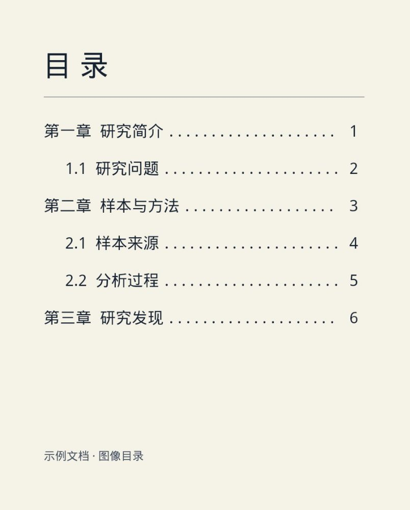
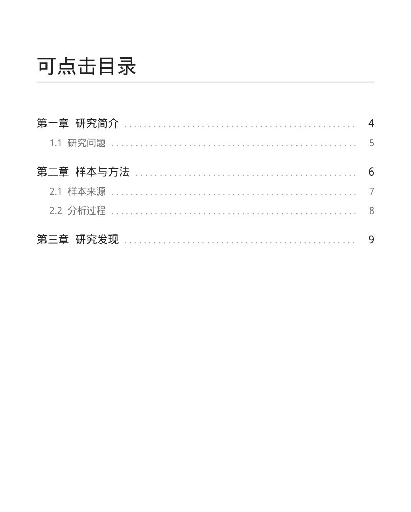

# PDFBookmarks AI

Add nested PDF bookmarks and a clickable table of contents to local PDFs. The MCP shows an image-only TOC to your vision-capable agent. The local tool resolves physical page numbers, writes a new PDF, then checks every bookmark and generated link.

[PDFBookmarks website](https://pdfbookmarks.com/ai-tools) · [中文说明](README.zh-CN.md) · [Download a release](https://github.com/Yuikij/pdfbookmarks-ai/releases/latest)

<!-- mcp-name: io.github.Yuikij/pdfbookmarks -->

## Try a scanned table of contents

| Scanned original | Generated clickable TOC |
| --- | --- |
| [](examples/scanned-contents.pdf) | [](examples/with-bookmarks.pdf) |

Put the [sample scan](examples/scanned-contents.pdf) in the folder you allow the tool to access. Try this prompt in your agent.

> Use PDFBookmarks to add nested sidebar bookmarks and a clickable TOC to `scanned-contents.pdf`. Read the TOC image, verify the first and last chapter openings, keep the Chinese titles, and save a new PDF.

The example produces six verified bookmarks and six clickable links. The first printed page is original physical page 3. Adding a TOC at the front shifts that destination to output page 4.

## Install

### Agent Skill

```sh
npx skills add Yuikij/pdfbookmarks-ai --skill pdf-bookmarks
```

The skill works with the MCP or the CLI. Use the MCP with an image-capable client to pass PDF pages directly to the agent.

### Local MCP with npm

Requires Node.js 22.13+. Install the published GitHub Release archive with npm or point your MCP client's local stdio configuration at it:

```json
{
  "mcpServers": {
    "pdfbookmarks": {
      "command": "npx",
      "args": [
        "--yes",
        "https://github.com/Yuikij/pdfbookmarks-ai/releases/download/v0.1.0/pdfbookmarks-mcp-0.1.0.tgz",
        "serve",
        "--root",
        "/absolute/path/to/pdfs"
      ]
    }
  }
}
```

Replace the folder with one you want to share with the MCP. Repeat `--root` to grant another folder. Without `--root`, the server uses active MCP workspace roots if the client exposes them. On Windows, use a fully qualified folder path with escaped backslashes in JSON. If your client uses `servers` or a dedicated UI, enter the same `command` and `args` there.

### Desktop bundle and Python

The [GitHub Release](https://github.com/Yuikij/pdfbookmarks-ai/releases/latest) also includes a local `.mcpb` bundle for compatible desktop clients and a Python wheel. The bundle uses the desktop client's Node runtime. The wheel uses the same engine and brings in Node through its declared Python dependency. Both include the document processing dependencies. See the release for supported platforms and install commands.

### CLI

```sh
npm install -g https://github.com/Yuikij/pdfbookmarks-ai/releases/download/v0.1.0/pdfbookmarks-mcp-0.1.0.tgz
pdfbookmarks-mcp call pdf_inspect --root '/path/to/pdfs' --json '{"path":"book.pdf"}'
pdfbookmarks-mcp call pdf_render_page --root '/path/to/pdfs' --json '{"path":"book.pdf","page":3}' --image-out 'preview.jpg'
```

Run `pdfbookmarks-mcp tools` for schemas. After installation, use the installed command directly for offline processing.

## Tools

| Tool | Result |
| --- | --- |
| `pdf_inspect` | Page count, embedded page labels, existing outline and the file fingerprint |
| `pdf_read_pages` | Selected pages' text and an indication when the text layer is sparse or empty |
| `pdf_render_page` | Full-page or cropped JPEG as native MCP image content |
| `pdf_plan_bookmarks` | Resolved destinations, issues, sample and chapter anchors to verify |
| `pdf_write_bookmarks` | A new PDF, saved after all outline and generated TOC destinations are checked |

Page arguments use 1-based physical pages. Printed numbering can use an offset, verified PDF labels, or explicit physical page numbers for mixed numbering. The tool reads only allowed folders and never overwrites an existing output. PDFs are processed locally. If your agent uses a hosted model, selected text and images returned to the client may be sent to that model. Raw PDF bytes are not sent by this server. Encrypted and digitally signed PDFs require a separate unencrypted or unsigned copy before editing.

## Develop

Run `npm ci` and `npm test`. Generate fresh demo PDFs in an empty folder with `node scripts/demo.mjs /path/to/demo`. The test suite exercises the actual stdio client, JPEG output, page mapping, Chinese bookmarks and link verification.

MIT for project code. The bundled [Droid font](fonts/README.md) is Apache-2.0.
